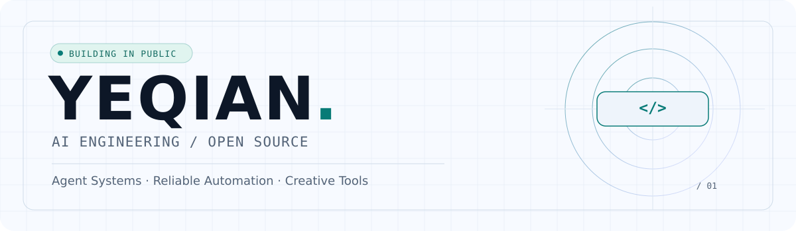

  <picture>
    <source media="(prefers-color-scheme: dark)" srcset="./assets/hero-dark.svg" />
    <source media="(prefers-color-scheme: light)" srcset="./assets/hero-light.svg" />
    
  </picture>

  <h3>你好，我是叶纤 / YeQian 👋</h3>
  
<strong>让 AI 不止停留在 Demo，而是真正成为可靠的生产系统。</strong>

  
AI Engineering · Agent Systems · Developer Experience · Creative Automation

  <a href="https://github.com/yeqiana?tab=repositories">所有项目</a>
  &nbsp;·&nbsp;
  <a href="https://github.com/yeqiana/AgentOps">AgentOps</a>
  &nbsp;·&nbsp;
  <a href="https://github.com/yeqiana/StroyOS">StoryOS</a>

---

### 🧭 我在做什么

我关注 **AI Agent 的工程化落地**：从任务编排、工具调用与模型路由，到质量审核、失败恢复和自动化交付。也在探索 AI 如何帮助内容创作、日常开发和复杂系统治理。

- 🤖 **构建 Agent 运行时**：多模型接入、工具系统、任务编排、追踪与治理。
- 🎬 **把创作变成流程**：让故事从构思、审核、生产到交付可验证、可恢复。
- 🛠️ **改善 AI Coding 工作流**：最小充分改动、自动化校验、结果可追溯。

### 🚀 代表作品

| 项目 | 方向 | 简介 |
| :--- | :--- | :--- |
| [**StoryOS**](https://github.com/yeqiana/StroyOS) | AI Content · Workflow | 面向 AI 图文故事的生产系统，串联故事审核、视觉一致性、内容返修与交付流程。 |
| [**AgentOps**](https://github.com/yeqiana/AgentOps) | AI Agents · Runtime | 面向企业场景的 Agent 后端底座，涵盖模型接入、工具调用、异步任务、编排与可观测性。 |
| [**AI Coding Guardrails**](https://github.com/yeqiana/ai-coding-collaboration) | Developer Experience | 为 Codex / Claude Code / Cursor 提供轻量任务分级、最小改动、验证和交付规范。 |
| [**Distributed Systems Audit**](https://github.com/yeqiana/distributed-system-audit) | Reliability · Testing | 从真实执行链路、状态不变量、并发与故障恢复角度审核分布式系统。 |

### 🧰 技术关注

  
  
  
  
  
  

`Agent Runtime` · `Workflow Orchestration` · `Reliable Automation` · `AI Coding` · `System Observability`

### 🐍 贡献轨迹

<picture>
  <source media="(prefers-color-scheme: dark)" srcset="https://raw.githubusercontent.com/yeqiana/yeqiana/output/github-contribution-grid-snake-dark.svg" />
  <source media="(prefers-color-scheme: light)" srcset="https://raw.githubusercontent.com/yeqiana/yeqiana/output/github-contribution-grid-snake.svg" />
  
</picture>

---

Build useful things. Keep systems reliable. ✦

